# 萌部落社区

这是一个日漫萌系、水色主题的多用户社区。在这里可以发帖、评论、发私信、签到升级，主页右下角还住着一只会陪你聊天的猫娘「奶糖」。

后端由 6 个 Java 微服务和 1 个 Python AI 服务组成，前端用 Vue 3。这是个兴趣项目，也用来练手微服务架构：服务按业务域拆分，同步调用只保留几条固定的只读路径，跨服务的联动全部走事件消息。


演示视频：[meng_center_demo.mp4](meng_center_demo.mp4)（92 秒，从注册审核一路演示到服务架构与事件流。视频录得比较早，当时三个角色的「萌萌」页面后来合并成了现在的奶糖助手，后续加上的语音和桌宠也没有收录进去）。

**快速跳转：** [功能一览](#功能一览) · [奶糖助手](#奶糖助手) · [社区功能](#社区功能) · [架构](#架构) · [快速开始](#快速开始) · [测试](#测试) · [文档](#文档)

## 功能一览

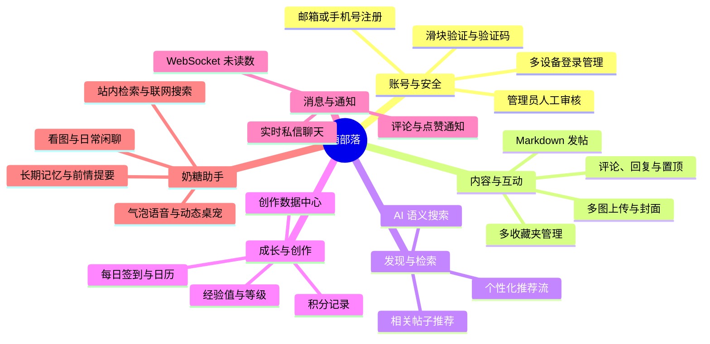

## 奶糖助手


奶糖是站在主页右下角的全身 Q 版猫娘（琪露诺同人二创）。点她就能打开对话框聊天——她有自己独特的说话口吻，能看懂你发的图片，能帮你找站内帖子、读帖子正文、查你自己的发帖和成长数据，遇到站外的事也能联网搜索（有每日次数限制，回复下方会附上网页来源），还会记住你以前聊过的事。

她和用户的关系最高到「朋友」，不会往恋人方向发展。关于关系界限、现实生活优先以及危机干预的规则写在[奶糖助手](docs/meng.md)第 6 节，优先级高于角色设定。


### 一轮对话是怎么跑的

每一轮对话里，额度扣减、会话加锁、上下文组装和最终落库都由 Java 的 `companion` 服务负责，Python 的 `ai` 服务只管生成内容。生成的结果必须先通过安全与人设检查才会发给前端，因此前端收到的都是审核通过的完整气泡。

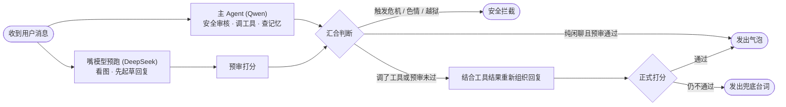

- **闲聊加速**：闲聊时，主 Agent 和「嘴模型起草 + 预审」同时开跑，两边一汇合就能直接发出；不调工具时首个气泡的 P50 耗时目标在 3 秒以内。
- **断线不断生成**：中途关掉对话框或断开连接不会打断后台生成；生成期间如果又发了新消息，会自动排队，等当前这轮结束后合并成下一轮一起回复。
- **前缀缓存**：主 Agent 固定不变的系统提示词使用了百炼原生的显式缓存断点，缓存的创建量和命中量会分开记录。

### 记忆机制

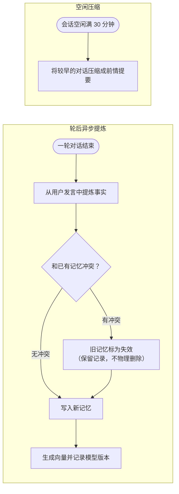

正在聊天时不改动上下文前缀，这样缓存命中率更高。就算用户主动清空了记忆，后续聊天也能重新开始记；召回记忆时还会区分向量模型的版本。完整规则见 [AI 公共运行时](docs/ai-runtime.md)。

### 气泡语音


气泡上带有声波图标和时长，点击后才会播放。语音念的不是死板的书面文字，而是专门改写过的口语稿，配音语气由主 Agent 根据对话场景挑选；气泡里显示的文字则始终是审核通过的原话。

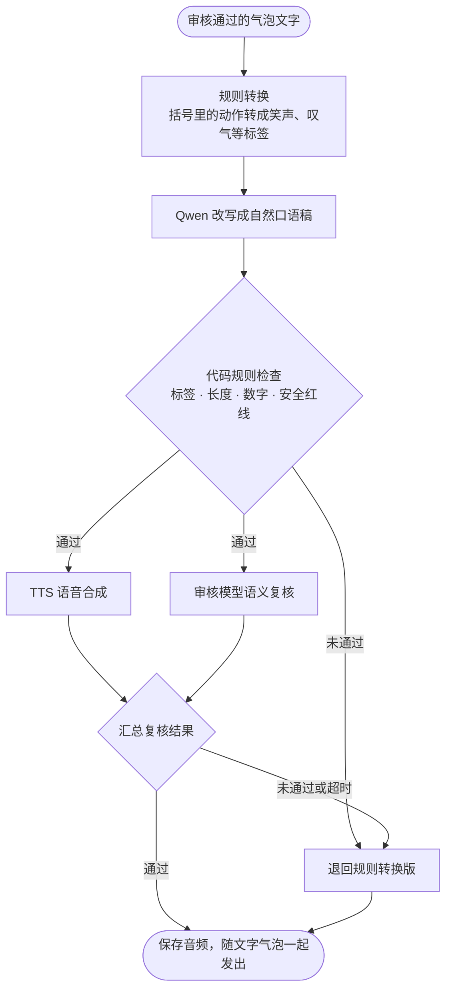

语音合成调用百炼 `Qwen-Audio-3.1-TTS-Flash`（音色 `longling_v3.1`）。每种语气对应一句语气说明和一组语速、音高、音量参数，口语稿里还能穿插拟声词、语气标签和 SSML 停顿。就算语音合成失败，这个气泡也会正常展示文字，不影响整轮回复。详细规则见[奶糖助手](docs/meng.md)第 5.2.1 节。

### 桌面小宠

奶糖平时安静待机，只有遇到明确事件才会切换动作，不会一直在页面上循环乱动。

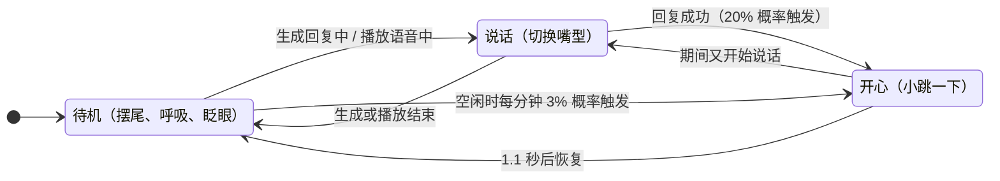

关掉对话框后，后台回复会继续生成，右下角的她也会继续动嘴说话。素材按身体、尾巴、眼睛、嘴巴以及开心的三个姿势分层切图，全部加起来约 193KB。如果系统开启了「减少动态效果」，则只显示静态站姿。

## 社区功能

### 账号与注册审核

注册账号需要先过滑块验证和短信/邮箱验证码，提交后进入待审核状态，等管理员通过后才能正常登录。如果被驳回，登录时能看到具体原因，修改资料后可以重新申请。同一个账号支持在多台设备登录，在个人中心里可以随时让任意一台设备下线。


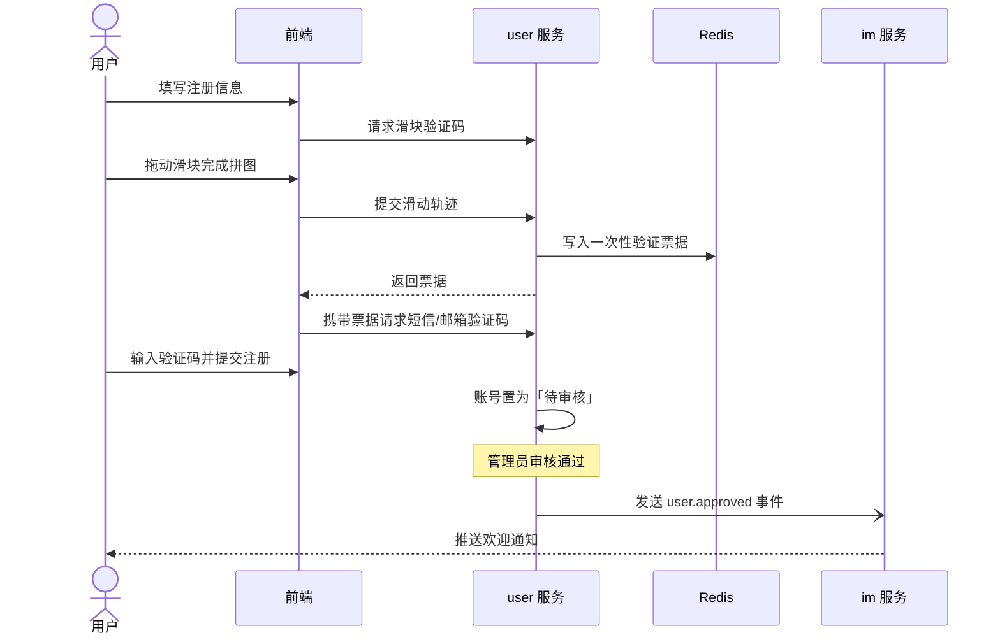

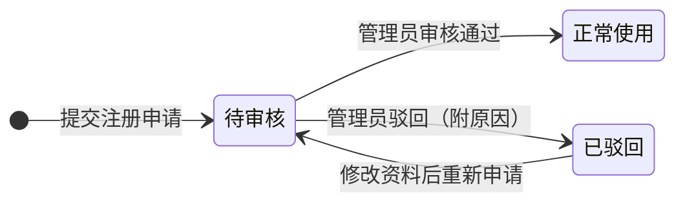

目前没有单独的管理端前端页面，注册审核直接调后端的管理员接口，接口规格见[认证模块](docs/auth.md)。

### 发帖与浏览

帖子分为五个分类，正文用 Markdown 编写，最多可传 10 张配图，支持设置封面和标签，也可以先存草稿。主页提供推荐、最新、热门三种排序（默认按推荐）。评论支持带图和表情包，可以置顶、点赞和 `@` 提到其他用户；收藏帖子时还能归类到不同的收藏夹。


帖子发布后会异步交给 AI 分析和审核——发帖本身不用等 AI 跑完，就算 AI 服务暂时不可用也能照常发帖。如果审核判定违规，帖子会自动退回草稿箱，并通过系统通知告知作者原因。

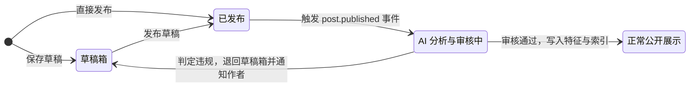

### 搜索

搜索默认按「相关度」排序：先用向量检索召回最多 20 篇候选帖子，再让 AI 重排并判断哪些真正相关。如果向量服务或 AI 不可用，会自动退回关键词检索，保证搜索结果正常返回；切换到「热门」或「最新」排序时则直接走关键词检索。


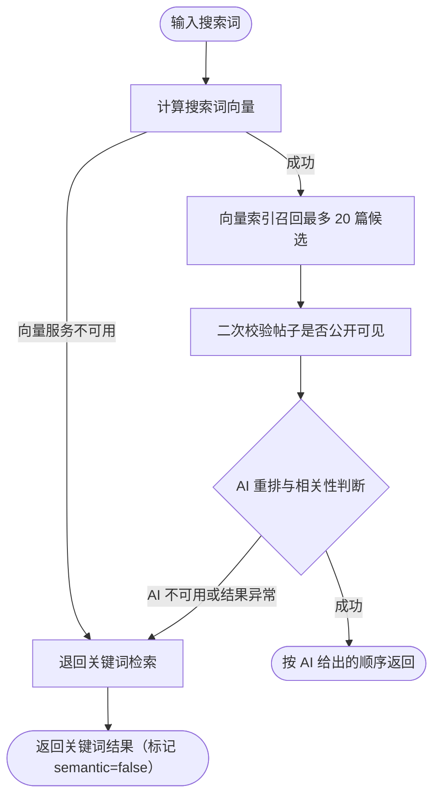

### 创作中心与成长体系

创作中心帮作者汇总了浏览、喜欢、评论和收藏数据，包含近期趋势图和帖子热度排行。图表库做了按需加载，只有点开可视化视图时才会加载。


日常签到、发帖、发评论都会增加经验值，经验值决定用户等级；同时还会累积积分（积分是独立的账户，目前只做记录）。成长中心集中展示等级之路、月度签到日历、今日任务和经验明细。


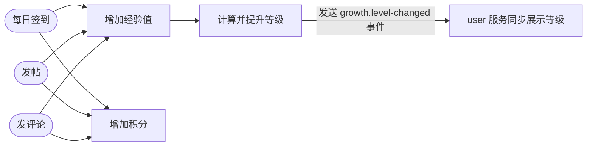

### 消息与个人中心

消息中心分为「私信」「评论」「喜欢」和「系统」四个标签页。私信支持文字、表情、图片、已读回执、消息撤回和在线状态展示，也可以直接屏蔽对方。导航栏上的未读消息数通过一条 WebSocket 长连接实时更新。


个人中心可以修改昵称、签名、头像和用户名，换绑邮箱和手机号，管理登录设备，以及查看关注和粉丝列表。修改后的昵称、签名和头像会交给 AI 审核，未通过的内容会被自动清除，并在消息中心说明原因。


## 架构

每个业务服务独占自己的 MySQL 数据库，绝不直接跨库读别人的表。

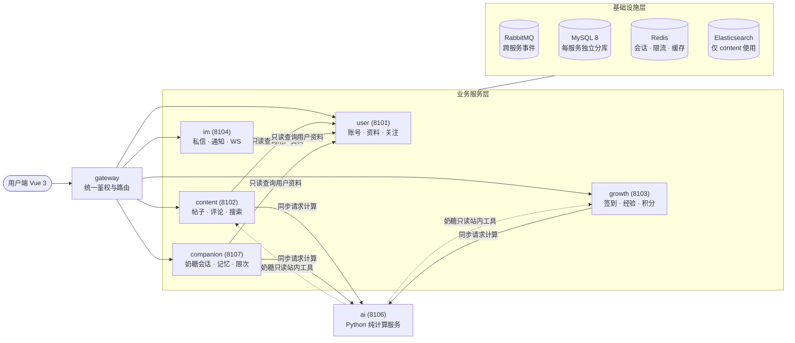

| 服务 | 端口 | 职责说明 |
|---|---:|---|
| `gateway` | 8080 | 路由转发、统一鉴权、注入身份请求头、拦截外部对内部路径的访问 |
| `user` | 8101 | 账号体系、登录认证、个人资料、注册审核、关注关系 |
| `content` | 8102 | 帖子、评论、点赞、收藏、关键词与向量索引、个性化推荐 |
| `growth` | 8103 | 经验值、等级计算、每日签到、积分记录 |
| `im` | 8104 | 私信聊天、互动与系统通知、WebSocket 实时推送 |
| `ai` | 8106 | 帖子理解、内容审核、推荐计算、奶糖单轮对话图（纯计算，不存业务状态） |
| `companion` | 8107 | 奶糖助手的会话编排、长期记忆维护、调用限次 |

核心防耦合规则（详见[架构设计](docs/architecture.md)）：

- **同步调用只读且定死方向**：同步调用只允许出现在固定方向上，全部只读、调用深度为 1。唯一的例外是奶糖对话：`companion` 调 `ai` 后，`ai` 的站内工具会只读调用 `content` 和 `growth`。
- **跨服务联动全走事件**：一件事发生后需要其他服务跟着反应时，一律在事务提交后发送 RabbitMQ 事件。
- **Java 掌握业务权威状态**：权限、额度、计费和最终业务状态全部由 Java 服务决定；Python `ai` 服务只做计算和给建议，不能绕过业务服务直接改数据。
- **网关统一收口身份**：下游服务只认网关注入的身份请求头，绝不信任前端传来的用户 ID 和角色。

### 一次发帖背后的事件流

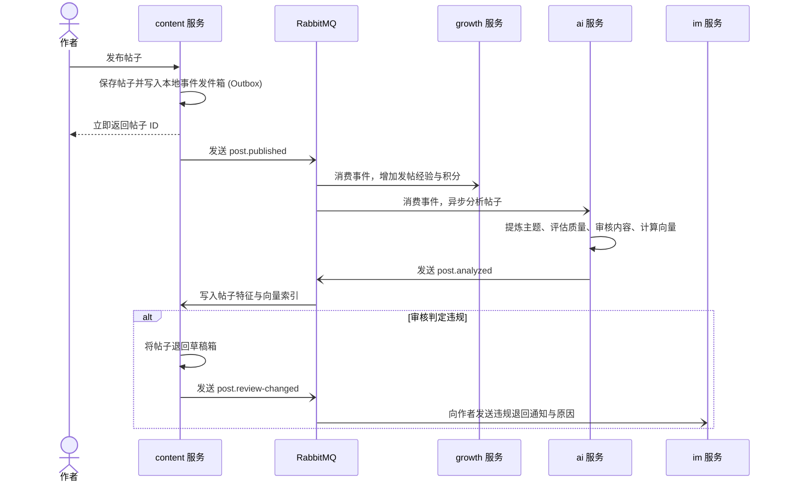

### 模型分工

所有大模型能力统一经由阿里云百炼接入：

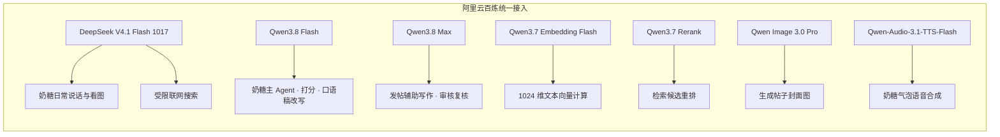

### 技术栈

| 层级 | 选型 |
|---|---|
| Java 后端 | JDK 17、Spring Boot 4.0、Spring Cloud 2025.1、Spring Cloud Alibaba、MyBatis-Plus、Flyway |
| AI 服务 | Python 3.12、FastAPI、LangChain 1.x、LangGraph 1.x、uv |
| 中间件 | MySQL 8、Redis、RabbitMQ、Elasticsearch、Nacos、xxl-job |
| 前端 | Vue 3、vue-router、Pinia、Axios、Element Plus、SCSS、Vite |
| 运行方式 | Docker Compose 启动本地中间件，业务服务以 JAR 和 uvicorn 在本机直接运行 |

### 目录结构

```text
meng_center/
├── docs/                 项目文档
├── deploy/               Docker Compose、Nacos 配置、初始化与启动脚本
├── java_backend/         Java 后端（Maven 多模块）
├── python_ai/            Python AI 服务
├── vue_front/            Vue 3 用户端前端
├── verification/         联调、压测与浏览器自动化验证脚本
└── meng_center_demo.mp4  92 秒项目演示视频
```

Java 后端里每个业务域对应顶层的一个 server 模块，各域对外暴露的内部契约统一放在 `meng-api` 下：

```text
java_backend/
├── meng-common/       统一响应、异常与业务码、通用工具、分页、JWT、Web 拦截器
├── meng-api/          各域对外契约：内部只读接口、DTO/VO、MQ 事件体
├── meng-gateway/      网关服务
├── meng-user/         用户域服务
├── meng-content/      内容域服务
├── meng-growth/       成长域服务
├── meng-im/           消息域服务
└── meng-companion/    奶糖助手服务
```

## 快速开始

本机运行需要准备：Windows 11、PowerShell 7、Docker、JDK 17、Node.js、uv（Maven 直接用 IDEA 自带的即可）。

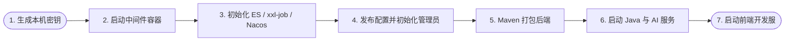

**第一步：生成密钥、启动中间件并完成初始化**

```powershell
./deploy/scripts/Initialize-LocalEnvironment.ps1
./deploy/scripts/Start-Middleware.ps1
./deploy/scripts/Initialize-Elasticsearch.ps1
./deploy/scripts/Initialize-XxlJob.ps1
./deploy/scripts/Initialize-Nacos.ps1
./verification/Test-Middleware.ps1
```

第一条脚本只会为尚未设置的环境变量生成随机密钥并写入当前用户的环境变量，已有的变量不会被覆盖。所有密钥只保存在本机用户环境变量里，绝不进代码仓库。

**第二步：发布配置、打包并启动后端与 AI 服务**

先对 `java_backend/pom.xml` 执行一次 Maven `package`，然后发布配置并启动各个服务：

```powershell
./deploy/scripts/Publish-NacosConfiguration.ps1
./deploy/scripts/Initialize-Administrator.ps1
./deploy/scripts/Start-Backend.ps1 -Service meng-user
./deploy/scripts/Start-Backend.ps1 -Service meng-gateway
./deploy/scripts/Start-Ai.ps1
```

需要启动其他 Java 服务时，把 `-Service` 换成 `meng-content`、`meng-growth`、`meng-im` 或 `meng-companion` 即可（每个服务单独占一个终端窗口）。

**第三步：启动前端**

```powershell
cd vue_front/front_user
npm ci
npm run dev
```

启动后访问 <http://127.0.0.1:5173>，前端请求会通过 Vite 代理转发到网关。完整的启动步骤、端口列表和环境变量说明见[本地中间件](deploy/README.md)和[环境、密钥与约定](docs/setup.md)。

## 测试

| 命令 | 说明 |
|---|---|
| `./verification/Test-Backend.ps1` | 运行全部 Java 后端模块的单元测试与 ArchUnit 架构测试 |
| `./verification/Test-Companion.ps1` | 运行奶糖助手的 Java 测试、Python 静态检查与单元测试 |
| `./verification/Test-Ai.ps1` | 运行 AI 服务的静态检查与单元测试 |
| `./verification/Test-Functional.ps1` | 隔离环境下的注册、审核、登录、改密完整联调 |
| `./verification/Test-Secrets.ps1` | 扫描仓库中是否误提交了环境变量里的密钥字面值 |

前端在 `vue_front/front_user` 目录下执行 `npm run lint`、`npm run lint:style` 和 `npm run build`。更多按域拆分的联调与浏览器回归脚本见[验证说明](verification/README.md)。调用真实大模型会按 Token 计费，真实冒烟和验收评测的额度约束见 [AI 公共运行时](docs/ai-runtime.md)第 11.2 节。

## 文档

| 文档 | 内容 |
|---|---|
| [架构设计](docs/architecture.md) | 项目定位、技术栈、服务划分、防耦合规则，以及全项目的暂不做、待定与待核实清单 |
| [事件与内部接口](docs/contracts.md) | 跨服务 MQ 事件与内部只读接口的完整清单及新增规范 |
| [认证模块](docs/auth.md) | 注册、登录、找回密码、管理员审核，以及个人中心与设备管理 |
| [内容域](docs/content.md) | 帖子、评论、配图、热榜、搜索、收藏夹与创作中心 |
| [成长域](docs/growth.md) | 每日签到、经验值、等级体系与积分 |
| [消息域](docs/im.md) | 私信、互动与系统通知、WebSocket 实时连接 |
| [AI 公共运行时](docs/ai-runtime.md) | 模型网关、奶糖单轮对话图、上下文与缓存、审核子图、检索、安全与评测 |
| [AI 域](docs/ai.md) | 帖子理解、个性化推荐、语义搜索、发帖 AI 辅助、成长总结与内容审核 |
| [奶糖助手](docs/meng.md) | 角色设定、长期记忆、对话链路、气泡语音、关系界限与安全、接口与页面 |
| [前端规范](docs/frontend.md) | 目录结构、三文件拆分、设计变量与静态检查工具 |
| [环境、密钥与约定](docs/setup.md) | 本机环境准备、环境变量清单与命名约定 |
| [本地中间件](deploy/README.md) | 中间件容器启动、端口分配与凭据约定 |
| [验证](verification/README.md) | 单元测试、隔离联调、浏览器脚本与压测基线 |
| [仓库卫生规则](AGENTS.md) | 什么能进仓库、临时产物放哪、提交前自查清单 |

## 目前没有做的东西

- **管理端页面**：管理端前端已经移除，后端的管理员接口仍在，页面规格保留在文档中。
- **积分消费**：积分目前只做获取和流水记录，还没有兑换或消费场景。
- **线上部署**：目前只支持本机开发运行，还没做云服务器部署配置。
- **外部运营条件**：正式用户协议和短信通道需要运营者自行配置，默认关闭注册提交和真实短信发送（见[环境、密钥与约定](docs/setup.md)第 4 节）。
- **其他待办**：其余暂不做或待定的事项统一记在[架构设计](docs/architecture.md)第 10 节。
