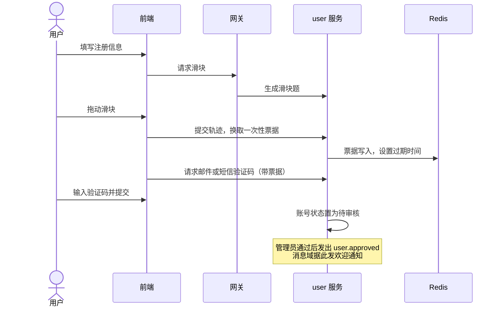
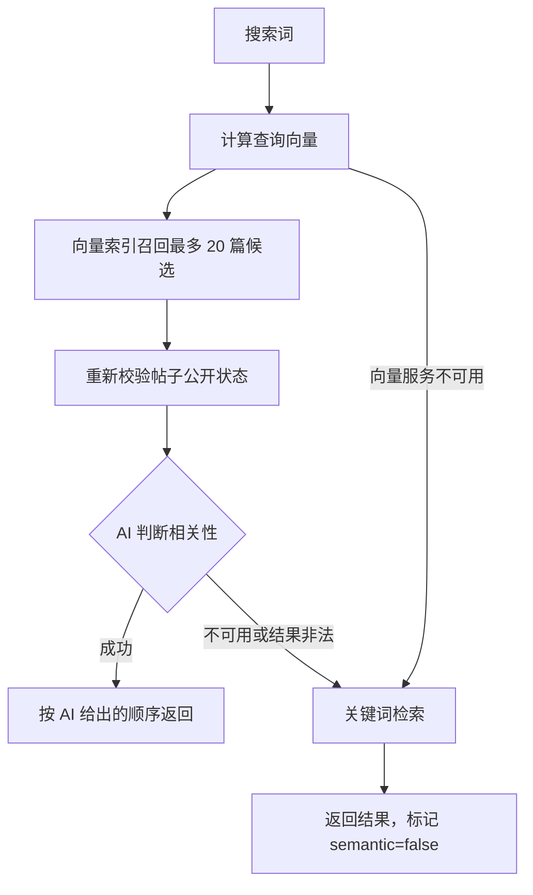
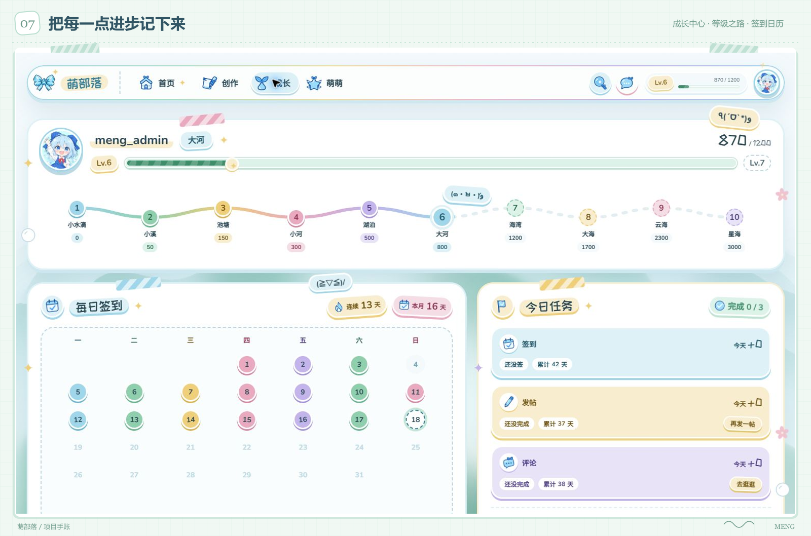
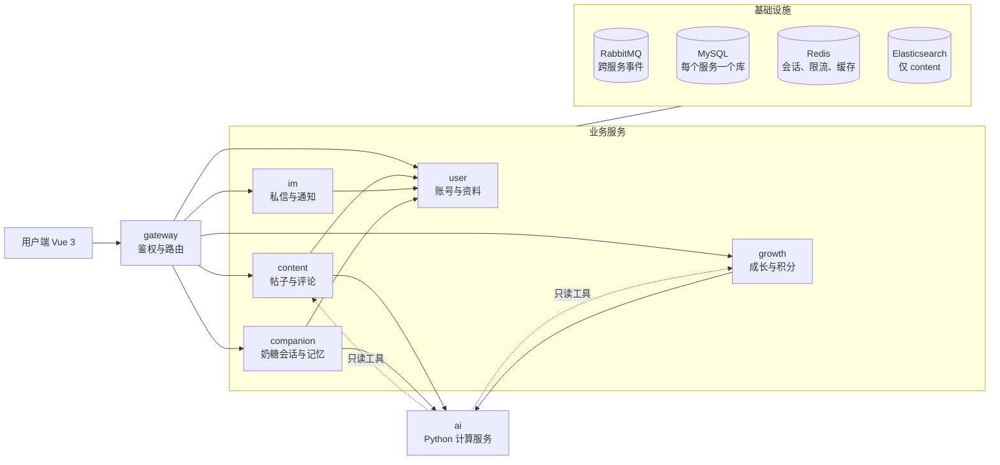
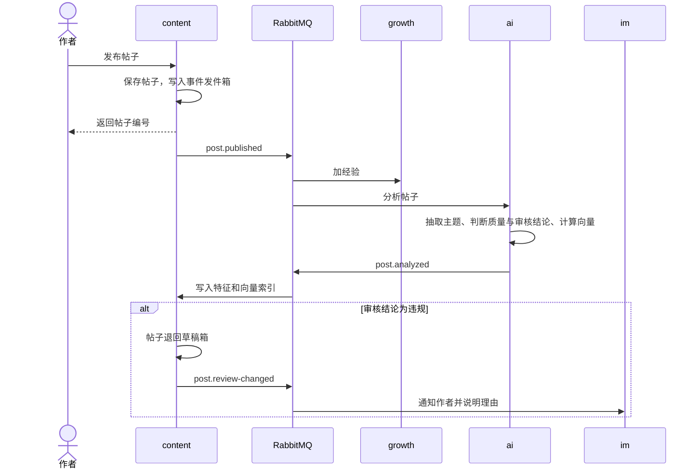
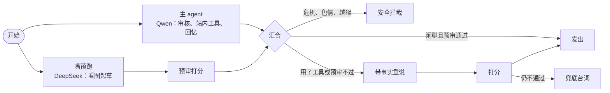

# 萌部落社区

萌部落是一个日漫萌系、水色主题的多用户社区。用户可以发帖、评论、私信，有签到和等级，主页还有奶糖助手可以聊天。后端是 Java 微服务加一个 Python AI 服务，前端是 Vue 3。

这是一个兴趣项目，也是几种技术放在一起的练习，所以首要目标是好维护、好扩展：服务按业务域拆分，同步调用只保留少数几条固定方向，其余都走事件。

## 演示视频

[meng_center_demo.mp4](meng_center_demo.mp4)，92 秒：注册审核、主页、发帖、语义搜索、创作中心、成长、消息、个人中心，再到旧版萌萌的三个角色，最后是架构和一次发帖的事件流。萌萌现在已缩成主页的奶糖助手，视频里的三角色页面是旧版。

## 功能

### 账号与审核

注册需要邮箱或手机号，并通过滑块验证和验证码。提交后账号处于待审核状态，管理员通过后才能登录。被拒绝的用户能看到原因，可以重新申请。同一个账号可以在多台设备上登录，个人中心里能看到每台设备并让它下线。




目前没有管理端页面。审核通过、驳回等操作只能调后端的管理员接口，接口规格见 [认证模块](docs/auth.md)。

### 发帖与浏览

帖子分五个分类，正文用 Markdown，可以带最多十张配图、封面和标签，也可以先存成草稿。主页的帖子流有推荐、最新、热门三种排序，推荐是默认。详情页有评论和回复，评论可以带图和表情，支持置顶、点赞和 @ 提到。喜欢和收藏都有计数，收藏可以放进不同的收藏夹。


### 搜索

搜索框默认按相关度排序：先用向量找出候选帖子，再由 AI 判断哪些真正相关。AI 不可用时退回关键词检索，结果照常返回。热门和最新两种排序直接走关键词检索。




### 创作中心

作者可以看到自己帖子的浏览、喜欢、评论、收藏的汇总，近期趋势图，以及按热度排序的帖子表现。图表库在点开可视化时才加载。


### 成长

签到、发帖、评论都会增加经验，经验决定等级。成长中心展示等级之路、月签到日历、今日任务和经验明细。积分是独立于经验的账户，签到、发帖、评论获得。



### 消息

消息中心分私信、评论、喜欢和系统四个标签页。私信支持文字、表情、图片、已读回执、撤回和在线状态，也可以屏蔽对方。导航栏的未读数通过一条 WebSocket 实时更新。


### 个人中心

可以修改昵称、签名、头像和用户名，更换或绑定邮箱和手机号，管理登录设备，查看关注和粉丝。昵称、签名和头像会经过 AI 审核，未通过的内容会被清除，并在消息中心里说明原因。


### 奶糖助手

主页右下角的小助手，形象是琪露诺的猫娘打扮（同人二创）。登录后点开对话框，奶糖用自己的口吻做基本问答：能看用户发来的图，能找站内帖子、读帖子、查用户自己的帖子和成长数据，也记得用户以前说过的事。关系最高到朋友，不会发展成恋人。

关系界限、现实生活优先和危机处理这些规则写在 [奶糖助手](docs/meng.md) 第 6 节，优先级高于角色设定。

发送失败可恢复原文字和图片并重试；记忆按当前有效事实去重，清空后可以重新记住，召回时区分向量模型版本。开发验证只调用离线假模型，真实冒烟和验收按文档中的授权额度执行。

运行时的每日看板可通过 `verification/Export-AiRuntimeDashboard.ps1` 只读导出；帖子向量迁移状态通过 `verification/Test-VectorEncoding.ps1` 检查。这两个命令都不调用模型，具体用法见 [验证说明](verification/README.md)。

## 架构

后端按业务域拆成六个 Java 服务，加一个 Python 的 AI 服务。每个服务有自己的数据库，不直接读别人的表。



| 服务 | 端口 | 负责 |
|---|---:|---|
| gateway | 8080 | 路由、统一鉴权、注入身份头、拦截内部路径 |
| user | 8101 | 账号、登录、资料、注册审核、关注关系 |
| content | 8102 | 帖子、评论、点赞、收藏、搜索与向量索引、推荐 |
| growth | 8103 | 经验、等级、签到、积分 |
| im | 8104 | 私信、通知、WebSocket |
| ai | 8106 | 帖子理解、审核、推荐计算、奶糖一轮的图，不存任何业务状态 |
| companion | 8107 | 奶糖助手的会话编排、记忆、限次 |

几条固定的规则，细节见 [架构设计](docs/architecture.md)：

- 同步调用只有少数固定方向，而且只读，深度为 1。唯一的例外是奶糖助手：companion 调 ai，ai 的站内工具再只读地调 content 和 growth。
- 一件事发生后别的服务要跟着反应，一律走 RabbitMQ 事件，事务提交后才发送。
- 权限、额度、计费和最终的业务状态由 Java 决定。AI 服务只做计算和给出建议，不能绕过业务服务改数据。
- 身份只来自网关注入的请求头，不信任前端传来的用户编号和角色。

### 一次发帖会触发什么



发帖不会等 AI。分析通常在几秒内完成，AI 不可用时帖子照常发布，分析在队列里延后处理。

### 奶糖的一轮对话

对话由 companion 编排：额度、会话锁、取上下文和最终落库都在 Java；ai 只负责生成。一轮的结果在检查通过后才发给前端，所以前端收到的是一个个完整的气泡，不是逐字输出。



- 闲聊时 agent 和「嘴加预审」同时跑，汇合就能发；工具只处理用户明确提出的查询请求。无工具首个气泡 P50 的目标为 3 秒以内；验收同时检查缓存命中、事实依据和说话方式，服务健康不代表全部指标达标。
- 断开连接不会中止生成；同一个对话里生成中再发的消息会排队，结束后合并成一轮回复。
- 记忆在对话之后异步整理：从用户自己的话里提炼事实，取代的旧事实标记失效、不删除；会话空闲 30 分钟后才压缩较早的历史，聊天中不动前缀，缓存命中更高。编排和上下文的完整规则见 [AI 公共运行时](docs/ai-runtime.md)。

## 技术栈

| 层 | 选型 |
|---|---|
| 后端 | JDK 17，Spring Boot 4.0，Spring Cloud 2025.1，Spring Cloud Alibaba，MyBatis-Plus，Flyway |
| AI 服务 | Python 3.12，FastAPI，LangChain 1.x，LangGraph 1.x，使用 uv 管理依赖 |
| 模型 | DeepSeek 官方接口：DeepSeek V4.1 Flash（奶糖说话和看图）；阿里云百炼：Qwen3.8 Flash / Max（判断、agent 与写作）、Qwen3.7 Embedding Flash（向量，1024 维）、Qwen3.7 Rerank（重排）、Qwen Image 3.0 Pro（生图） |
| 中间件 | MySQL 8、Redis、RabbitMQ、Elasticsearch、Nacos、xxl-job |
| 前端 | Vue 3，vue-router，Pinia，Axios，Element Plus，SCSS，构建用 Vite |
| 部署 | Docker Compose 启动本地中间件；业务服务以 JAR 和 uvicorn 在本机运行 |

## 目录

```
meng_center/
├── docs/            文档，图片在 docs/images
├── deploy/          Compose、Nacos 配置、初始化与启动脚本
├── java_backend/    Java 后端，Maven 多模块
├── python_ai/       AI 服务
├── vue_front/       用户端
├── verification/    联调、压测和浏览器验证脚本
└── meng_center_demo.mp4  演示视频
```

Java 模块的布局是：每个业务域一个 server 模块放在顶层，所有域对外的契约集中在 `meng-api`。

```
java_backend/
├── meng-common/       统一响应、异常、工具、分页、JWT
├── meng-api/          各域的对外契约：内部接口、DTO、事件
├── meng-gateway/
├── meng-user/
├── meng-content/
├── meng-growth/
├── meng-im/
└── meng-companion/
```

## 快速开始

需要 Windows 11、PowerShell 7、Docker、JDK 17、Node.js、uv。Maven 使用 IDEA 自带的，不需要另装。

先启动中间件并初始化：

```powershell
./deploy/scripts/Initialize-LocalEnvironment.ps1
./deploy/scripts/Start-Middleware.ps1
./deploy/scripts/Initialize-Elasticsearch.ps1
./deploy/scripts/Initialize-XxlJob.ps1
./deploy/scripts/Initialize-Nacos.ps1
./verification/Test-Middleware.ps1
```

第一条脚本只会为不存在的变量生成密钥，写入用户环境变量，已有的值不改。所有密钥都只放在用户环境变量里，不进仓库。

再发布 Nacos 配置、打包后端并启动服务：

```powershell
./deploy/scripts/Publish-NacosConfiguration.ps1
./deploy/scripts/Initialize-Administrator.ps1
./deploy/scripts/Start-Backend.ps1 -Service meng-user
./deploy/scripts/Start-Backend.ps1 -Service meng-gateway
```

`Start-Backend.ps1` 对其他服务的用法相同，把 `-Service` 换成 `meng-content`、`meng-growth`、`meng-im`、`meng-companion`。AI 服务用 `./deploy/scripts/Start-Ai.ps1` 启动。启动前都要先对 `java_backend/pom.xml` 执行一次 `package`。

最后启动前端：

```powershell
cd vue_front/front_user
npm ci
npm run dev
```

用户端在 <http://127.0.0.1:5173>，请求经 Vite 代理转到网关。完整的步骤、端口表和环境变量清单见 [本地中间件](deploy/README.md) 与 [环境、密钥与约定](docs/setup.md)。

## 测试

| 命令 | 内容 |
|---|---|
| `./verification/Test-Backend.ps1` | 全部后端模块的单元测试和架构测试 |
| `./verification/Test-Companion.ps1` | 奶糖助手的 Java 测试、Python 静态检查和测试 |
| `./verification/Test-Ai.ps1` | AI 服务的静态检查和测试 |
| `./verification/Test-Functional.ps1` | 注册、审核、登录、改密的完整联调 |
| `./verification/Test-Secrets.ps1` | 扫描仓库里有没有密钥的值 |

前端在 `vue_front/front_user` 下用 `npm run lint`、`npm run lint:style`、`npm run build` 检查。其他联调和浏览器脚本见 [验证](verification/README.md)。

## 文档

| 文档 | 内容 |
|---|---|
| [架构设计](docs/architecture.md) | 定位、技术栈、服务划分、防耦合规则，全项目的暂不做、待定与待核实 |
| [事件与内部接口](docs/contracts.md) | 跨服务交互的完整清单和新增流程 |
| [认证模块](docs/auth.md) | 注册、登录、找回密码、审核，以及个人中心 |
| [内容域](docs/content.md) | 帖子、评论、配图、热榜、搜索、收藏夹 |
| [成长域](docs/growth.md) | 签到、经验、等级、积分 |
| [消息域](docs/im.md) | 私信、通知、实时连接 |
| [AI 公共运行时](docs/ai-runtime.md) | 奶糖和站内 AI 共用：模型、奶糖一轮的图、上下文与缓存、审核子图、检索、安全、评测 |
| [AI 域](docs/ai.md) | 帖子理解、推荐、语义搜索、发帖页 AI 入口、成长总结、审核 |
| [奶糖助手](docs/meng.md) | 设定、记忆、对话链路、关系界限与安全、接口、页面 |
| [前端规范](docs/frontend.md) | 目录、三文件拆分、不硬编码的做法、检查工具 |
| [环境、密钥与约定](docs/setup.md) | 本机环境、环境变量清单、命名约定 |
| [本地中间件](deploy/README.md) | 启动、端口与凭据约定 |
| [验证](verification/README.md) | 测试和联调脚本、压测基线 |
| [仓库卫生规则](AGENTS.md) | 什么能进仓库，干完活要收拾什么 |

## 目前没有的东西

- 管理端前端已经移除。管理员接口仍然在，页面规格留在文档里。
- 积分目前只用来记录。
- 上线部署没有做，现在只支持在本机运行。
- 正式的用户协议和短信通道需要运营者提供，当前默认关闭注册提交和短信发送，见 [环境、密钥与约定](docs/setup.md) 第 4 节。
