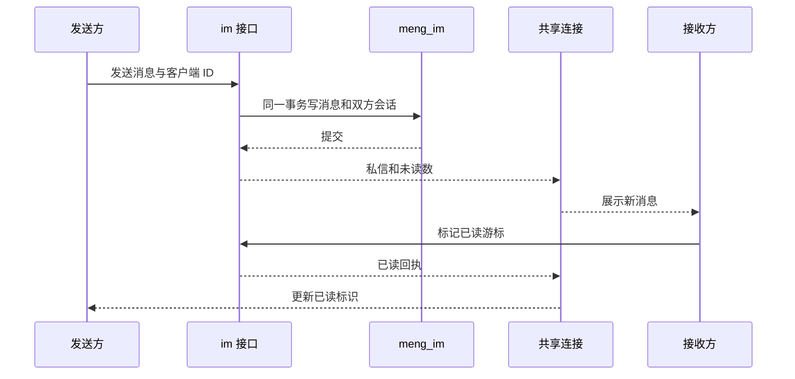

# 萌部落社区 · 消息域

> 配套文档：[架构设计](architecture.md)、[事件与内部接口](contracts.md)、[内容域](content.md)、[成长域](growth.md)、[前端规范](frontend.md)。

## 1. 范围

- **本期**：消息中心页面、私信（文字、表情、图片和图集、已读回执、在线状态、屏蔽、删除会话）、通知（评论和回复、喜欢和收藏、系统通知）、导航上的未读数。
- **暂缓**：撤回、群聊、「对方正在输入」、私信举报、通知清理、中奖通知（抽奖还没做）。
- **依赖别人先做完**：举报通知要等 content 的管理端举报处理上线并发出 `report.handled`。

## 2. 整体方案

- 服务 `meng-im`，独占库 `meng_im` 和账号 `meng_im_app`，只监听本机 8104 端口，经网关的 `/im/**` 访问。
- im 只同步调 user 的批量用户接口拿昵称和头像；不被任何服务同步调用。通知全部来自消费事件。
- **一条 WebSocket 管全部实时推送。** 登录后全站常连，通知、未读数、私信、已读回执、在线状态都走它。不用 SSE：HTTP/1.1 下同一域名最多 6 条连接，多开几个标签页就会把普通请求堵住。
- **连接只推不收业务。** 发消息、标记已读都走普通 HTTP 接口，校验、限流、错误码和别的接口一致。客户端在连接上只发心跳和「我在看谁」。
- **数据库是准的。** 推送丢了不影响正确性：不在线不补推，上线或重连后用 HTTP 重新拉。
- im 按单实例运行，连接表放内存。以后要多实例时，推送经 RabbitMQ 的 fanout 交换机广播给每个实例（各自一个临时队列，消息十秒过期），在线状态改放 Redis 带过期时间的键。不用 Redis 发布订阅做广播：它不缓存不确认，订阅端断一下就丢，而用户的连接还在，不会触发重新拉取。
- 不用 STOMP、SockJS，不自建 Netty 服务，不给聊天消息再套一层 MQ。

## 3. 接口

均在 im 服务，均需登录。

| 接口 | 用途 |
|---|---|
| `GET /im/unread` | 私信、评论、喜欢、系统四类各自的未读数 |
| `GET /im/notifications` | 通知列表，参数 `channel`、`source` 或 `category`、`page`、`size` |
| `GET /im/notification-groups` | 某个频道下左栏的分组（来源或类型），每组带最新一条的摘要、时间、未读数 |
| `PUT /im/notifications/read` | 把某个频道下某一组标成已读 |
| `GET /im/conversations` | 会话列表，分页 |
| `GET /im/conversations/peer/{userId}` | 打开和某人的会话。还没聊过时返回空壳，不建会话 |
| `GET /im/conversations/{id}/messages` | 历史消息，游标翻页，参数 `beforeId`、`size`（默认 30） |
| `POST /im/messages` | 发消息。带对方 id、客户端消息 id、文字、图片 id 列表 |
| `PUT /im/messages/{id}/revocation` | 撤回自己发出不超过 5 分钟的消息，重复撤回不报错 |
| `PUT /im/conversations/{id}/read` | 标记读到哪一条 |
| `DELETE /im/conversations/{id}` | 删除会话，只对自己隐藏 |
| `POST /im/images` | 上传一张私信图片，返回图片 id |
| `GET /im/images/{id}` | 读私信图片，参数 `thumb` 取缩略图 |
| `POST /im/blocks`、`DELETE /im/blocks/{userId}` | 屏蔽、取消屏蔽 |
| `GET /im/blocks` | 我的屏蔽名单，分页，新屏蔽的在前；每项是对方的 id、展示名、头像和屏蔽时间 |
| `GET /im/settings`、`PUT /im/settings` | 在线状态设置：自动或隐身 |
| `GET /im/ws` | WebSocket 握手 |

- 通知列表默认每页 10 条。喜欢频道返回的是聚合后的条目（见 5.3）。
- 没有「只取一条通知」的接口，通知点了直接跳到对应的帖子或评论。
- 请求字段：发送为 `{peerId, clientMsgId, content, imageIds}`；会话已读为 `{messageId}`；通知已读为 `{channel, source, category}`，系统频道只传 category，其他通知只传 source；设置为 `{hidden}`；屏蔽为 `{userId}`。
- 频道枚举为 COMMENT / LIKE / SYSTEM；来源为 POST；系统分组为 GROWTH / REPORT / APPROVAL / FOLLOW（有人关注了你，通知类型 `FOLLOWED`，触发人是关注者，同一对人只通知一次）。REPORT 保留设计稿中的分组，目前没有处理事件，显示空状态。
- 未指定对方时默认打开列表中最近的会话；没有会话时展示空状态。会话响应带对方资料、双方已发条数和已读游标；历史响应为 `{records, hasMore}`。会话与通知列表沿用 `PageResult`。通知条目为 `{notice, actors}`，喜欢的 notice 额外带 actorCount。

## 4. 私信

### 4.1 规则

- 一对一。一条消息可以带文字（最多 500 字，可带表情记号，最多 10 个）和图片（1 到 10 张），两者至少有一样，可以同时发。表情记号和评论用同一套，见[内容域](content.md)。
- 会话在第一条消息发出时才建，不产生空会话。
- **陌生人限制**：对方回复之前，最多发 3 条。
- **屏蔽**：被屏蔽的人发不出消息。屏蔽不删历史，也不通知对方。
- **删除会话**只对自己隐藏，并记下当时的最后一条消息；对方再发消息时会话重新出现，只显示之后的消息。
- 不能给自己发；对方不存在或不是正常状态时发不出。
- 发送在一个事务里完成：写消息、更新双方的会话行（未读数、预览、时间、已发条数）。提交后再推送。
- 同一个发送人的客户端消息 id 唯一，重复提交返回第一次的结果。

### 4.1.1 撤回

- 只能撤回自己发出、不超过 5 分钟（含）的消息。时间以数据库为准：更新语句里直接比较发送时间，过了时限更新不到行，返回 409 `IM_REVOKE_EXPIRED`。已经撤回的再撤回返回当前状态，不报错。
- 撤回只在消息上记 `revoked_time`，文字和图片都不删。对方读到的撤回消息没有文字和图片（接口返回时置空，读图接口也拒绝），自己读到的撤回消息仍带文字，用来重新编辑。
- 消息响应带 `revoked` 和 `revokeMillis`（离撤回截止还剩多少毫秒，不能撤回时为 0）。前端用单调时钟从收到的时刻起算截止点，不拿本机时间和服务器时间比，到点按钮自己消失；点击时刚好过期的以服务器的 409 为准。
- 撤回后：如果对方还没读到这条，它的未读数减一；如果它是会话里最新的一条，两边列表里的摘要分别改成「你撤回了一条消息」「对方撤回了一条消息」。已读回执计数不回退。陌生人限制的发送条数不退还，防止撤回后继续刷。
- 事务提交后向双方推 `dm.revoke`（会话 id、消息 id、发送人 id），并刷新对方的未读数。

### 4.2 已读回执

- 不逐条记已读。每人在会话里只存「读到哪一条」。
- 打开会话或收到新消息且窗口在前台时，前端调标记已读；服务端清零未读数并把「读到哪一条」推给对方。
- 前端用「消息 id 不大于对方读到的 id」判断这条是否已读。

### 4.3 图片

- im 自己上传和存储，做法同内容域：存本机磁盘，读写集中在一个存储类，上传时生成宽 480 的缩略图。
- 只能发自己上传、还没挂到别的消息上的图片。
- **读图要鉴权**：只有会话双方能读，其他人一律 404。这一点和公开的帖子配图不同。
- 一条消息里的图片和表情合起来多于一个时，前端显示成图集：第一个当封面，叠放效果，角标写还有几个；点一下用图片查看器看全部，和帖子里的配图一样，不在原地展开。只有一个时直接放在气泡里。

### 4.4 在线状态

- 有至少一条连接就算在线，多个标签页按连接数计。断开后等 10 秒再判离线，避免刷新页面时闪一下。
- 个人设置两档：自动（默认）和隐身。隐身时别人看到的一直是离线。
- 只在聊天窗顶部显示对方的在线状态。前端打开聊天窗时在连接上订阅对方，关掉时取消；服务端只把变化推给订阅的人。会话列表不显示在线状态。

## 5. 通知

### 5.1 频道与来源

| 频道 | 内容 | 左栏分组 | 事件 |
|---|---|---|---|
| 评论 | 评论我的帖子、回复我的评论 | 按来源，现在只有「帖子」 | `comment.created` |
| 喜欢 | 帖子被喜欢、帖子被收藏、评论被喜欢 | 按来源，现在只有「帖子」 | `post.liked`、`post.favorited`、`comment.liked` |
| 系统 | 成长通知、举报通知、审核通知 | 按类型 | `growth.level-changed`、`report.handled`、`user.approved` |

- 来源和类型都是枚举字段，以后加新来源（例如萌萌回答下的评论）或新类型（例如 AI 审核结果）只加枚举值，页面结构不变。

### 5.2 规则

- 自己对自己的操作不产生通知。
- 每条通知有一个去重键并加唯一索引。同一个人对同一目标反复点喜欢只留一条；取消喜欢不撤回通知。事件重复到达不会多出通知。
- 通知存结构化字段：类型、触发人 id、帖子 id、评论 id、帖子标题快照、评论摘要、等级。文案由前端按类型拼，等级名也在前端。
- 原帖或评论被删后不回头清通知，点进去是详情页的「不存在」状态。
- 打开左栏某一组，这一组整体标成已读。
- 举报通知发给两方：举报人收到处理结果（成立或不成立）；举报成立、内容被移除时，内容的作者也收到一条，不透露举报人是谁。

### 5.3 喜欢的聚合

- 存储仍然一人一条。列表接口按「目标 + 动作」分组，每组返回总人数、最新两个人、最新时间，按最新时间倒序分页。
- 喜欢和收藏是两个动作，不合成一条。
- 一组里只要有未读的，这一条就算新的。

## 6. 实时连接

- 握手自动带上 HttpOnly Cookie，网关验完注入身份头，im 不解析 JWT。
- 帧是一段 JSON：`{type, data}`。

| 方向 | 类型 | 用途 |
|---|---|---|
| 服务端推 | `dm.message` | 新私信，同时推给发送人的其他标签页 |
| 服务端推 | `dm.read` | 对方读到哪一条 |
| 服务端推 | `dm.revoke` | 有消息被撤回，同时推给双方 |
| 服务端推 | `notice.new` | 新通知，带频道 |
| 服务端推 | `unread` | 四类未读数 |
| 服务端推 | `presence` | 订阅的那个人上线或下线 |
| 客户端发 | `ping` | 25 秒一次，保活和探测断线 |
| 客户端发 | `presence.watch`、`presence.unwatch` | 订阅、取消订阅某人的在线状态 |

- 服务端 60 秒收不到心跳就关掉连接。
- 前端断线后指数退避重连（1 秒起，最长 30 秒），重连成功后重新拉未读数和当前会话。

## 7. 数据表

独占库 `meng_im`。每张表都有 `id`、`create_time`、`update_time`、`delete_state`。

### 7.1 `notification`

| 字段 | 说明 |
|---|---|
| `receiver_id` | 接收人 |
| `channel` | 评论、喜欢、系统 |
| `source` | 来源，评论和喜欢频道用；现在只有帖子 |
| `category` | 系统频道的类型：成长、举报、审核 |
| `type` | 具体类型，例如帖子被喜欢、评论被回复、升级 |
| `actor_id` | 触发人，系统通知为空 |
| `post_id`、`comment_id` | 目标，可空 |
| `post_title`、`excerpt`、`original_excerpt` | 帖子标题快照、评论摘要和被回复的原评论摘要（各 60 字以内） |
| `level` | 升级到几级，可空；举报字段随管理端处理事件接入时补充 |
| `read_state` | 是否已读 |
| `dedupe_key` | 去重键，唯一索引 |

索引：`(receiver_id, channel, id)`；`(receiver_id, channel, read_state)`。

### 7.2 `conversation`

| 字段 | 说明 |
|---|---|
| `user_low_id`、`user_high_id` | 两个用户 id 按大小排，联合唯一 |

### 7.3 `conversation_member`

每个会话两行，一人一行。

| 字段 | 说明 |
|---|---|
| `conversation_id`、`user_id` | 联合唯一 |
| `peer_id` | 对方 |
| `unread_count` | 未读数 |
| `sent_count` | 自己已发条数，用于陌生人限制 |
| `last_read_message_id` | 自己读到哪一条 |
| `last_message_preview`、`last_message_time` | 列表用的预览和时间 |
| `hidden_state` | 自己是否删除了会话 |
| `cleared_message_id` | 删除会话时的最后一条消息 id，之前的不再显示 |

索引：`(user_id, hidden_state, last_message_time)`。

### 7.4 `private_message`

| 字段 | 说明 |
|---|---|
| `conversation_id` | 所属会话 |
| `sender_id` | 发送人 |
| `type` | 文字、图片；带图片的是图片，可以同时带文字 |
| `content` | 文字内容（含表情记号），只有图片时为空 |
| `client_msg_id` | 客户端消息 id，和 `sender_id` 联合唯一 |

索引：`(conversation_id, id)`。

### 7.5 `message_image`

| 字段 | 说明 |
|---|---|
| `uploader_id` | 上传者 |
| `message_id` | 可空。上传时为空，发消息时填上 |
| `sort` | 在消息里的顺序 |
| 存储路径、缩略图路径、宽高、大小 | 同内容域的配图表 |

上传后一直没挂到消息上的图片本期不清理。

### 7.6 `user_block`

| 字段 | 说明 |
|---|---|
| `user_id`、`blocked_user_id` | 联合唯一 |

### 7.7 `im_user_setting`

| 字段 | 说明 |
|---|---|
| `user_id` | 唯一 |
| `hidden` | 是否隐身 |

没有记录时按自动处理，第一次修改时才建。

## 8. 限制

| 项 | 上限 |
|---|---|
| 文字 | 500 字，表情记号 10 个 |
| 一条消息的图片 | 10 张 |
| 发消息 | 每人每分钟 20 条 |
| 上传私信图片 | 每人每天 100 张 |
| 对方回复之前 | 3 条 |

限流计数放 Redis，键名 `meng:im:rate:msg:{userId}`、`meng:im:rate:image:{userId}:{日期}`；Redis 不可用时放行并记日志。

## 9. 权限与错误语义

| 情况 | HTTP 状态 | 业务码 |
|---|---|---|
| 参数不合法；文字和图片都没有；图片超过 10 张 | 400 | |
| 未登录 | 401 | |
| 被对方屏蔽 | 403 | `IM_BLOCKED` |
| 对方还没回复，已经发满 3 条 | 403 | `IM_WAIT_REPLY` |
| 读写不属于自己的会话；读别人会话里的图片；挂别人上传的图片 | 404 | |
| 对方不存在或不可用 | 404 | `IM_PEER_NOT_FOUND` |
| 给自己发消息 | 409 | `IM_SELF` |
| 撤回超过 5 分钟的消息 | 409 | `IM_REVOKE_EXPIRED` |
| 超过频率上限 | 429 | |

- 用户只能看和操作自己的会话和通知。身份只来自网关注入的请求头。
- 被屏蔽时的提示不说明原因，只说对方暂时不接收私信。
- 读别人的会话统一返回 404，不区分「不存在」和「无权限」。

## 10. 事件

im 只消费，不发事件。清单见 [contracts.md](contracts.md)。

- 每个事件一个队列，命名 `meng.im.<事件名>`。
- 消费失败先重试，再转入 `meng.im.dead`，不无限重入原队列。
- 靠 `dedupe_key` 的唯一索引保证幂等。

## 11. 前端

### 11.1 入口与骨架

- 路由 `/messages`，可带 `tab`（`chat`、`comment`、`like`、`system`）、`with`（对方用户 id）、`group`（通知分组）和 `page`（通知页码）。筛选和页码支持刷新、后退；非法值回退到默认值。
- 导航上的通知和私信合成一个入口：对话气泡图标，右上角是未读总数，超过 99 显示 `99+`，为零时不显示。
- 消息中心不带顶部导航栏，左上角有一个返回键回首页。
- 卡片外使用 PixelBlast 紫色圆点背景，保留缓慢流动与点击涟漪，鼠标移动不触发扰动；卡片内操作不触发背景交互。动态效果遵循减少动态效果设置，渲染与资源释放规则见 [前端规范](frontend.md)。
- 发私信的入口在帖子详情页：点作者或评论者的头像出小卡片，里面有「发私信」，跳到 `/messages?with=用户id`。

### 11.2 页面结构

按 `Messages.dc.html`：一张大卡，内容最大宽度 1480px，与首页共用外侧留白，中间一条竖向虚线分成左右两栏。四个标签页共用同一套卡片装饰，切换时卡片高度不变。

- **左栏**（桌面约 360px，占卡片约 28%）：标题和返回键同一行；下面一条切换条（私信、评论、喜欢、系统，带各自的未读数，放不下时横向滑动）；再下面是当前标签的列表；最底部隔一条横线，是自己的头像、昵称和在线状态按钮。对方没有头像时显示昵称首字的彩色圆形头像，有头像时正常显示，自己的默认头像仍使用统一素材。
  - 私信：会话列表，每行是头像、昵称、最后一条的预览、时间、未读数。表情记号在预览里显示成「[表情]」。屏蔽和删除会话在右侧聊天窗的顶栏里操作。屏蔽名单在个人中心的设置里查看和取消（见 [auth.md](auth.md) 13.6 节），删掉会话之后也能取消屏蔽。
  - 评论、喜欢：按来源分组，现在只有「帖子」一项。
  - 系统：按类型分组，成长通知、举报通知、审核通知。
  - 摘要里的昵称单独做成小标签，和后面的动作文字分开。
- **右栏**：横向虚线分成三段。
  - 私信：上面是对方的头像、昵称和在线状态；中间是消息；下面是输入区。
  - 通知：上面是标题和总条数；中间是列表；下面是翻页器。只有一页时也显示翻页器。
- **在线状态按钮**：绿点加「在线」或灰点加「隐身」，点开向上弹出两个选项。

### 11.3 聊天窗

- 对方的消息靠左，自己的靠右，都不显示头像。每条旁边有已读或未读标识：对方的消息标在气泡右侧，自己的标在左侧；自己发出还没过 5 分钟的消息，已读标识上面多一个「撤回」按钮，点击二次确认，确认后气泡淡出、换成占位，到点按钮向下淡出。
- 撤回后的消息变成居中的一行小字：自己的是「你撤回了一条消息」，末尾跟一个换了颜色的「重新编辑」，点击把文字和表情放回输入框（已有内容的话接在后面），图片不恢复；对方看到的是「对方撤回了一条消息」。
- 消息按时间从旧到新，相隔超过 5 分钟插一个时间标签。进入时停在最底部，往上滚动加载更早的。
- 一条消息里的文字、表情和图片按固定规则排版：文字在气泡里；表情和图片合起来只有一个时，放在气泡里文字的下一行；多于一个时，在气泡下面叠成一个图集（表情和图片混在一起，封面是第一个，角标写还有几个），点开用图片查看器看全部。表情不提供下载：查看器里不显示下载按钮，右键另存和拖拽也拦截。表情渲染成小图，面板与评论共用内置 `Emotions` 清单，包含十九张琪露诺 Q 版表情及兼容历史记号的旧表情；表情面板是一个宽的白边卡片，上面是当前系列的表情（系列内上下滚动），最下面一行是系列栏，现有「经典」「琪露诺」两个，后面留着位置给以后的新系列，系列在 `constants/comments.js` 的 `EmotionSeries` 里分组；图片和图集见 4.3，点单张看大图。
- 输入区：上面一排是「表情」「图片」，右侧显示已选的表情和已上传的图片（小方块，带移除按钮，上传中显示进度）；下面是自动伸缩的输入框，一行起步，最多三行，超出后框内滚动，字数在输入框内部右下角（只有一行时就在最右侧）；右侧的发送按钮和输入框等高。回车发送，Shift 加回车换行。图片太大、格式不对、张数超限这类提示统一用顶部的消息弹框，不在输入区上方显示红字。
- 聊天窗顶栏右侧依次是「屏蔽对方」勾选框、在线状态和删除会话按钮，勾选即屏蔽、取消勾选即取消屏蔽，删除前要二次确认；会话列表上不再有操作菜单。
- 被陌生人限制拦住时，输入区上方提示还能发几条；被屏蔽或对方不可用时输入区置灰。

### 11.4 通知列表

- 三个频道的卡片是同一种样式，一行一条，只按类型换颜色：评论紫色、喜欢粉色、收藏黄色，系统通知按类型绿、粉、蓝。未读的带一个「新」字标签。
- 评论：头像、昵称、动作、所属帖子标签、时间；下一行是评论内容；回复我的评论时再带一行我的原评论。整条可点，跳到帖子里那条评论的位置。
- 喜欢：最新两个人的头像叠放，「某某、某某 等 N 人」加动作；评论被喜欢时带一行我的原评论。
- 系统：小圆点、标题、关键信息、时间。成长通知的关键信息是等级变化，举报通知是处理结果和被举报的内容，审核通知是一句说明。

### 11.5 状态与数据

- 连接逻辑单独一个模块，登录后建立，退出登录时关闭。
- 一个 store 管未读数、会话列表、当前会话、在线状态，导航角标和消息中心共用。
- 每个列表都处理加载中、出错、未登录、空四种状态。
- 路由、图片预览与消息组件按页面加载；会话列表一次联表取得双方游标及屏蔽状态，用户资料和消息图片批量查询。快速切换会话或通知会取消旧请求，实时刷新合并短时间内的事件。上传复用有界队列、图片缩放及取消机制，离页释放对象 URL、观察器和监听器。
- 消息卡片最大为 1040px 高，随可用窗口高度收缩，桌面完整露出底部输入区；左栏按设计稿约占 28%。手机改为上下两段，聊天和通知内容在各自区域滚动，隐藏页面和内容区滚动条，保留鼠标、触摸与键盘滚动。入场、通知新增、按钮点击使用短时透明度和位移动画，减少动态效果时关闭。
- 评论通知跳转到 `#comment-{id}`；详情通过内容域的定位接口找到一级评论页和回复页，展开并突出目标。成长通知显示事件携带的新等级，不推断跨级升级前的等级。

- 发送中的消息先显示在列表里并置灰，失败时标红并可重发，重发沿用同一个客户端消息 id。

## 12. 验收点

私信：

- 两个账号互发文字、表情、图片，对方不刷新就能收到；发送方的其他标签页同步出现。
- 一次发 2 张及以上的图或表情显示成图集，点开能逐张看，表情没有下载按钮；发 11 张图被拒绝；文字加图片可以一起发。
- 第三个账号读不到这两个人的会话和图片，返回 404。
- 对方没回复时发第 4 条被拒绝并有提示；对方回复后恢复正常。
- 屏蔽后对方发不出；取消屏蔽后恢复。
- 屏蔽之后删掉会话，仍然能在个人中心的屏蔽名单里看到对方并取消屏蔽。
- 删除会话后列表里消失；对方再发，会话重新出现且只有新消息。
- 同一个客户端消息 id 提交两次只有一条消息。
- 对方打开会话后，自己这边的未读标识变成已读。
- 对方上线、下线、设成隐身，聊天窗顶部的状态相应变化；刷新页面时不闪离线。

通知：

- 评论帖子、回复评论、喜欢帖子、收藏帖子、喜欢评论，对方各收到一条；对自己的内容操作不产生通知。
- 反复点喜欢再取消，对方只有一条通知。
- 多人喜欢同一个帖子时聚合成一条，人数和头像正确。
- 升级、注册通过各产生一条系统通知，归到对应类型下。
- 打开某一组后未读数清零，导航角标同步减少。
- 同一个事件重复投递不产生重复通知；消费失败的进入死信队列。

连接：

- 未登录握手被拒绝。
- 断网后恢复能自动重连，并补上期间的未读数。
- im 停掉时发帖、评论、签到不受影响；im 恢复后积压的事件被消费。

## 13. 待定

| 事项 | 现状 |
|---|---|
| 举报通知 | 等 content 的管理端举报处理和 `report.handled` 事件 |
| 私信举报 | 暂缓。本期防骚扰靠陌生人限制和屏蔽 |
| 通知和未挂载图片的清理 | 本期不清理。以后加 xxl-job 任务 |
| 多实例 | 方向见第 2 节，本期不写代码 |
